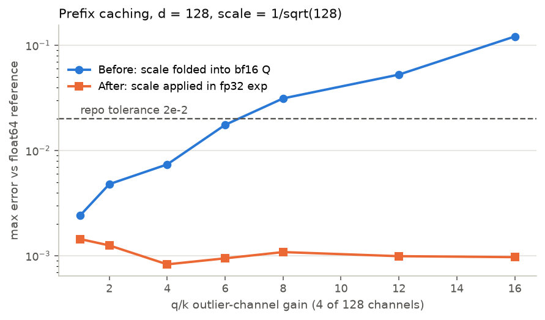
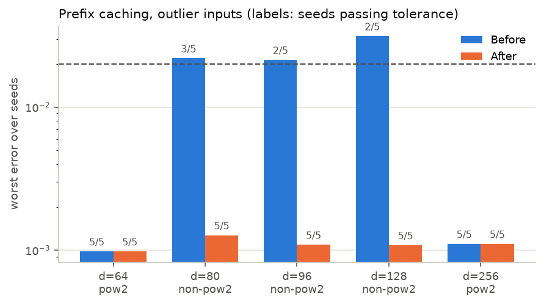
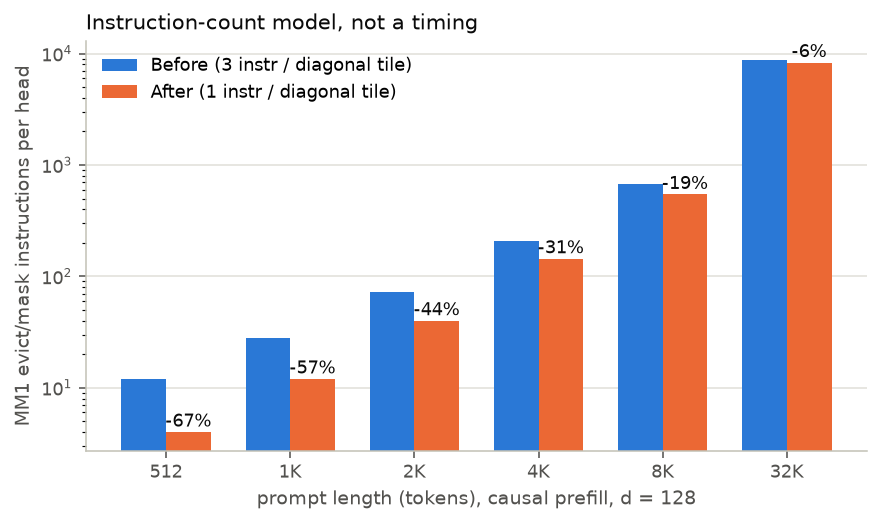

# attention_cte: non-power-of-two softmax scale, before vs after the patch

Validation of `attention_cte_fp32_scale_in_exp.patch` (base `ad2f1b9` of
[aws-neuron/nki-library](https://github.com/aws-neuron/nki-library), kernel
`src/nkilib_src/nkilib/core/attention/attention_cte.py`).

**Sections 1-5:** CPU emulation (numpy, bf16) of the kernel's arithmetic and decision logic.
**Section 6:** measured on Trainium2 hardware (trn2.48xlarge), running the patch's new test cases against both
the original and the patched kernel.

## Summary

| Result | Before | After | Source |
|---|---|---|---|
| Sequence packing, d=128, scale 1/sqrt(128) | **fails** (`range_select path doesn't support scale != 1.0`) | passes | trn2 hardware |
| New test cases | 7 pass, 2 fail, 1 skipped | 9 pass, 0 fail, 1 skipped | trn2 hardware |
| Prefix caching, d=128, outlier inputs: seeds within tolerance (0.02) | 2/5 | 5/5 | CPU emulation |
| Power-of-two scales (d=64, 256) | exact | identical (18 of 18 cases) | CPU emulation |
| Diagonal MM1 instructions, 512 to 4K tokens | 3 per diagonal tile | 1 per tile: -31% to -67% | instruction-count model, not a timing |

## The problem

Attention computes `softmax(scale * Q.K^T)`. The `range_select` masking instruction has no scale operand, so on the
prefix-caching, sliding-window, context-parallel and `kv_used_len` paths the kernel folded the scale into the bf16 Q
tile. For a power-of-two scale that is exact. For the scale most LLMs use at head size 128, 1/sqrt(128) = 0.0884, it
rounds every Q element. Sequence packing also uses `range_select` but was never added to the fold, so any scale other
than 1.0 hit `kernel_assert(ac.scale == 1.0)`. Plain causal prefill with a non-power-of-two scale could not use the
fast one-instruction diagonal.

## The patch

For a positive scale, keep the MM1 scores unscaled in fp32 and apply the scale inside the exp activation:
`exp(scale*s - scale*max)`. The flash-attention correction factor, the attention sink and the cached `out_neg_max`
are updated to match. Power-of-two scales keep the exact Q fold, and configs that do not need the new path emit the
same instructions as before.

## 1. Which path each config takes (d = 128, scale = 1/sqrt(128))

| Scenario | Before | After |
|---|---|---|
| plain causal | MM1 evict, fp32 | exp, fp32, fast diagonal |
| prefix caching | Q, bf16, rounded, fast diagonal | exp, fp32, fast diagonal |
| sliding window | Q, bf16, rounded | exp, fp32 |
| context parallel | Q, bf16, rounded | exp, fp32 |
| sequence packing | **fails**: assert ac.scale == 1.0 (L4290) | exp, fp32 |
| plain causal + position_bias | MM1 evict, fp32 | MM1 evict, fp32 |
| prefix caching + position_bias | **fails**: assert: position_bias needs scale=1 / >0 | exp, fp32, fast diagonal |

## 2. Accuracy vs outlier strength (CPU emulation)

Worst of 5 seeds, S = 2048, prefix caching, d = 128. Error = max|out - ref| / max|ref| against
float64 attention on the same bf16 inputs; the repo tolerance is 0.02. Outlier inputs (4 of 128 q/k channels
scaled) are a stylised assumption, not measured LLM activations.



| Outlier gain | 1 | 2 | 4 | 6 | 8 | 12 | 16 |
|---|---|---|---|---|---|---|---|
| Before (fold into bf16 Q) | 2.4e-03 | 4.8e-03 | 7.4e-03 | 1.8e-02 | 3.1e-02 | 5.3e-02 | 1.2e-01 |
| After (scale in fp32 exp) | 1.4e-03 | 1.3e-03 | 8.3e-04 | 9.5e-04 | 1.1e-03 | 9.9e-04 | 9.7e-04 |

## 3. Accuracy by head dimension (CPU emulation, outlier inputs)



| d | scenario | Before: worst err | pass | After: worst err | pass |
|---|---|---|---|---|---|
| 64 | plain causal | 1.15e-03 | 5/5 | 1.15e-03 | 5/5 |
| 64 | prefix caching | 9.83e-04 | 5/5 | 9.83e-04 | 5/5 |
| 64 | sliding window | 1.15e-03 | 5/5 | 1.15e-03 | 5/5 |
| 128 | plain causal | 1.05e-03 | 5/5 | 1.05e-03 | 5/5 |
| 128 | prefix caching | 3.13e-02 | 2/5 | 1.09e-03 | 5/5 |
| 128 | sliding window | 2.31e-02 | 2/5 | 1.05e-03 | 5/5 |
| 256 | plain causal | 1.12e-03 | 5/5 | 1.12e-03 | 5/5 |
| 256 | prefix caching | 1.11e-03 | 5/5 | 1.11e-03 | 5/5 |
| 256 | sliding window | 1.12e-03 | 5/5 | 1.12e-03 | 5/5 |

The repo's own tests use U[0,1) inputs, where attention is nearly uniform and every variant passes, so they cannot
show this difference.

## 4. Instruction count on the causal diagonal (model, not a timing)

128-row Q groups, 512-key tiles, tiles above the diagonal skipped. A diagonal tile goes from 3 instructions
(`tensor_copy` + GpSimd `affine_select` + evict) to 1 (`range_select`).



| Prompt | Full tiles | Diagonal tiles | Diagonal share | Before | After | Reduction |
|---|---|---|---|---|---|---|
| 512 | 0 | 4 | 100% | 12 | 4 | -67% |
| 1024 | 4 | 8 | 67% | 28 | 12 | -57% |
| 2048 | 24 | 16 | 40% | 72 | 40 | -44% |
| 4096 | 112 | 32 | 22% | 208 | 144 | -31% |
| 8192 | 480 | 64 | 12% | 672 | 544 | -19% |
| 32768 | 8064 | 256 | 3% | 8832 | 8320 | -6% |

## 5. Flash sections, sink and `out_neg_max` (CPU emulation)

Patch-style and upstream-style section loops compared bit for bit (d = 128). This shows the algebra is consistent
in emulation; on hardware a fused multiply-add could differ in the last fp32 bit.

| Sections | Sink | max abs out diff | max abs neg_max diff | Bit-identical |
|---|---|---|---|---|
| 1 | none | 0.0 | 0.0 | yes |
| 1 | 2.5 | 0.0 | 0.0 | yes |
| 1 | 20.0 | 0.0 | 0.0 | yes |
| 4 | none | 0.0 | 0.0 | yes |
| 4 | 2.5 | 0.0 | 0.0 | yes |
| 4 | 20.0 | 0.0 | 0.0 | yes |
| 8 | none | 0.0 | 0.0 | yes |
| 8 | 2.5 | 0.0 | 0.0 | yes |
| 8 | 20.0 | 0.0 | 0.0 | yes |

## 6. Device run: trn2.48xlarge, same test cases against both kernels

NKI 0.7.0, neuronx-cc 2.28, compile-and-infer on Trainium2. "Before" = original kernel with the patch's new test
file; "after" = patched kernel. Raw logs: [`results_device/`](results_device/).

| Case | Before | After |
|---|---|---|
| `no_cp_unit`, S=2048, d=128 | pass | pass |
| `no_cp_unit`, S=4096, d=128 | pass | pass |
| `no_cp_unit`, S=2048, d=96 | pass | pass |
| `no_cp_vnc_apc_klr_unit`, S=2048, d=128 | pass | pass |
| `no_cp_vnc_apc_klr_unit`, S=2048, d=128, sink | pass | pass |
| `no_cp_vnc_apc_klr_unit`, S=4096, d=128 | pass | pass |
| `no_cp_vnc_apc_klr_unit`, S=20480, d=128 | pass | pass |
| `ranged_attn_cte_sweep_nocp` | skipped | skipped |
| `seq_pack_unit`, S=2048, d=128 | FAIL | pass |
| `seq_pack_unit`, S=4096, d=128 | FAIL | pass |

Prefix caching with sink, S=2048: **84,426,534** cycles before, **84,426,535** after. An earlier run of the same case gave 84.66 M vs 86.46 M (+2.1%), so differences of that size are run-to-run noise, not the patch. (The cycle threshold on the new prefix-caching test rows was set to 1e12 in both trees to make the harness record cycles; that edit was made on the instance and is not part of the patch.)

**Not measured on device:**
- The plain-causal diagonal speedup. The test harness records cycles only for the prefix-caching group (the
  plain-causal test has a `FIXME` for cycles), so the section 4 numbers are still a model.
- Accuracy with outlier inputs. The suite's inputs are U[0,1), where every variant passes.
- The sweep case `test_ranged_attn_cte_sweep_nocp` was skipped in both runs.
- TTFT and tokens per second. The patch only touches prefill attention, and the GRPO benchmark in
  `../trl_grpo_ds1000_bench` does not call this kernel, so those benchmark numbers are unaffected today.

## Reproduce

```bash
pip install numpy ml_dtypes matplotlib
python run_experiments.py        # CPU experiments (about 1 minute; --quick for a smoke test)
python make_report.py            # charts in images/ (also writes an HTML report, not committed)
python make_readme.py            # regenerate this README
bash device/run_before_after.sh <path to nki-library-main>   # on a trn2 instance
```

| File | Purpose |
|---|---|
| `attention_cte_fp32_scale_in_exp.patch` | the patch (2 files, +100 / -22) |
| `common.py` | bf16 kernel emulation; scale decision logic before and after the patch |
| `run_experiments.py` | the five CPU experiments -> `results/*.json` |
| `make_report.py`, `make_readme.py` | charts and this README |
| `device/run_before_after.sh` | trn2 runbook (needs the venv `bin` on `PATH`, otherwise every compile fails with `python None`) |
| `results/`, `results_device/`, `images/` | CPU results, device logs and junit XML, chart PNGs |
