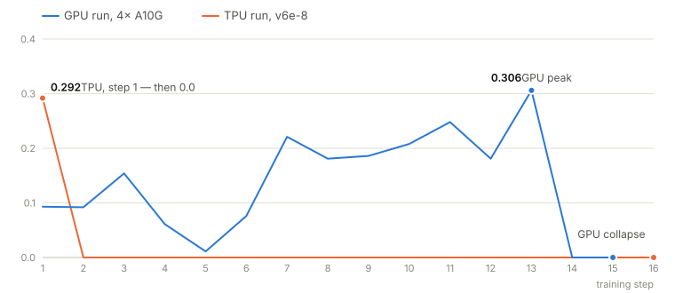

# SkyRL (NovaSky) on Cloud TPU: GRPO / RLVR on the Tinker SFT checkpoint

This folder contains the CholecT50 surgical action-triplet RL run on **SkyRL**.
The run uses **Google Cloud TPU**. It does not use GPUs.
It replicates the SkyRL GPU run in [`ft-rl-platform-benchmark-git/skyrl`](../../ft-rl-platform-benchmark-git/skyrl/README.md).

The TPU run uses the same items as the GPU run:

- The same SkyRL commit (`2c54cefc`) and the same trainer (`RayPPOTrainer`, GRPO, full model, KL 0.04).
- The same Tinker SFT checkpoint, the same 256 / 32 frames, and the same triplet-F1 reward.
- Each hyperparameter in [`SKYRL_CONFIG.md`](../../ft-rl-platform-benchmark-git/skyrl/config/SKYRL_CONFIG.md) of the GPU run.

The TPU run replaces only the parts that work only on CUDA: the training device, the rollout engine, and the weight sync.

**Status (2026-10-24, 12:50 UTC): Run 4 is in progress on one TPU v6e-8.**
**No run completed a full training step yet.** Section "Current status" gives the details.

## The task

| | |
|---|---|
| Dataset | CholecT50: endoscopic surgery frames, 256 train / 32 val (the same parquet as each leg) |
| Task | List each `instrument-verb-target` action triplet in a frame |
| Model | `Qwen/Qwen3.5-4B` (vision-language) |
| SFT checkpoint | Made on Tinker, merged (`s3://stanford-train-data/models/cholec-sft-qwen3.5-4b`) |
| RL stage | GRPO (RLVR) on SkyRL, full-model FSDP2 on TorchTPU |
| Reference | SkyRL GPU run: val reward 0.329 at the start. The training reward went to 0.0. The final eval did not occur (OOM). |

## Setup

This table shows the setup that is in use now (the single-VM layout).

| | GPU run (previous) | TPU run (this folder) |
|---|---|---|
| Hardware | 1× `g5.12xlarge` (4× A10G 24 GB) | 1× TPU `v6e-8` (Trillium, 8 chips × 32 GB, 2×4), spot, `europe-west4-a` |
| Host | 186 GB RAM | 180 vCPU, 1.4 TB RAM |
| GCP project | — | `tpu-rl-run` |
| SkyRL | `2c54cefc` | `2c54cefc` + `skyrl_patch/skyrl-tpu-on-2c54cefc.patch` |
| Policy | FSDP2 on `cuda`, 4 GPUs, CPU offload | FSDP2 on `tpu` (TorchTPU `torch_tpu==0.2.0`, `tpu_dist`), chips 0–3, CPU offload |
| Reference model | Colocated with the policy on 4 GPUs | 1 chip (chip 4), CPU offload |
| Rollouts | 4 local vLLM 0.31 engines, colocated | `rollout/rollout_server.py` on chip 6, HF `generate` on TorchTPU |
| Weight sync | `nccl` (CUDA IPC when colocated) | `reload`: the trainer writes bf16 weights to `/dev/shm`; the supervisor restarts the server on them |
| Attention / GDN kernels | flash-attn, fla + causal_conv1d | sdpa, pure-PyTorch Gated DeltaNet |

All 48 parameters in the GPU `SKYRL_CONFIG.md` have a check: 43 are the same, 5 have a TPU change, and 0 do not agree.
[`config/PARITY.md`](config/PARITY.md) gives the reason for each change.
`skyrl_cholect50/check_config_parity.py` does this check before each launch. It stops the launch if a different change occurs.

## Observations (so far)

| Requirement | SkyRL on TPU |
|---|---|
| Same SkyRL commit, trainer, data, reward, and hyperparameters as the GPU run | ✅ Parity check: 0 differences without a reason |
| TorchTPU training: policy on 4 chips, reference on 1 chip (P0) | ✅ All checks pass: TPU start, `tpu_dist`, all-reduce, FSDP2, train step, weight export, CPU offload |
| TorchTPU training: reference on 2 chips | ❌ The 2-chip group does not start (`START_SESSION failed`) |
| vLLM-TPU 0.32 serves Qwen3.5 with images | ⚠️ It works, but each frame takes approximately 80 s. This speed is too low for training. |
| HF engine on TorchTPU serves Qwen3.5 with images (P1) | ✅ 32 real val frames, greedy val reward **0.379** (GPU run: 0.329) |
| Weight reload on the real model | ✅ 24–25 s (stop the server, start it on the new weights) |
| SkyRL `eval_before_train` | ✅ **0.379**, 63 s |
| Rollouts for one step (128) | ✅ 80 s |
| Old + reference log-probs for one step | ✅ 12–18 min in step 1 (most of this time is compilation) |
| Policy update without CPU offload | ✅ 187 s; then the optimizer step stops with a TPU OOM |
| Policy update with CPU offload | ⏳ In progress in run 4 |
| Before/after val reward, TPU vs GPU | ⏳ full run in progress |

## Rewards so far

<picture>
  <source media="(prefers-color-scheme: dark)" srcset="docs/img/reward_per_step_dark.svg">
  
</picture>

The TPU run collapses after its first update. The GPU run with the same recipe trains for 13 steps and collapses at step 14.
Each point is the mean reward of the 128 rollouts in that step (`reward/avg_raw_reward`).

Why the TPU reward dropped to 0:

- **Step 1 moved the model too far.** One step (8 optimizer updates) changed the policy a lot: KL 1.3 to the reference model, and the log-probs of the rollout tokens shifted by 1.2 on average.
- **The reward is all or nothing on format.** A reply that does not parse as `instrument-verb-target` triplets scores 0. From step 2, all 128 replies scored 0.
- **GRPO then had no signal.** With equal rewards in each group, all advantages are 0. Only the KL term (0.04) was left to pull the model back, and it did not.
- **The model degenerated.** Replies grew to the 256-token limit from step 6, and the gradients went to 0 from step 7.
- **Cause not confirmed.** The weight sync is correct (rollout and trainer log-probs agree). In steps 2–6 the KL term should have moved the model back toward the reference, but KL went up. This points to a TPU gradient problem. The gradient check (`probes/p2_grad_parity.py`) will confirm or rule it out.

| Val reward (32 frames) | GPU run | TPU run |
|---|---|---|
| Before training | 0.329 | 0.379 |
| After training | not measured (out of memory at the final save) | 0.0 |

Train reward per step (table)

| Step | GPU run | TPU run |
|---|---|---|
| 1 | 0.093 | 0.292 |
| 2 | 0.092 | 0.000 |
| 3 | 0.154 | 0.000 |
| 4 | 0.061 | 0.000 |
| 5 | 0.011 | 0.000 |
| 6 | 0.076 | 0.000 |
| 7 | 0.221 | 0.000 |
| 8 | 0.181 | 0.000 |
| 9 | 0.186 | 0.000 |
| 10 | 0.208 | 0.000 |
| 11 | 0.248 | 0.000 |
| 12 | 0.181 | 0.000 |
| 13 | 0.306 | 0.000 |
| 14 | 0.000 | 0.000 |
| 15 | 0.000 | 0.000 |
| 16 | — | 0.000 |

Data: TPU run `cholect50-skyrl-tpu-20261024-121826` (`logs/fetched/…/metrics.jsonl`); GPU run `config/gpu_reference_final_results.json`.
To make the chart again: `python analysis/reward_chart.py logs/fetched/<run_id>`.
