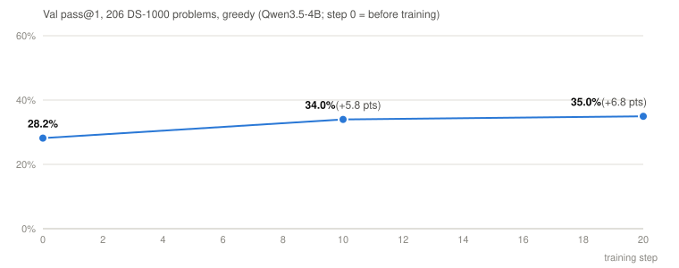
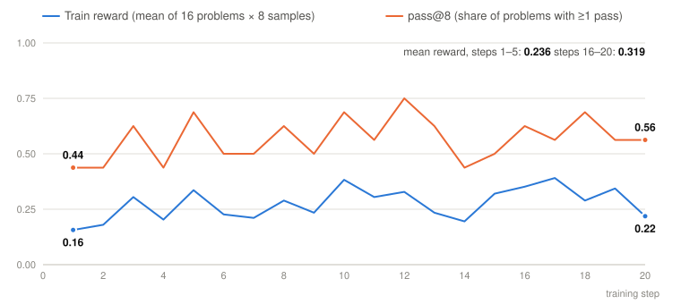
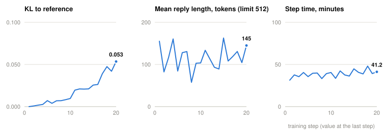

# DS-1000 on SkyRL (TPU)

GRPO on [DS-1000](https://github.com/xlang-ai/DS-1000) (Lai et al., ICML 2023; [xlangai/DS-1000](https://huggingface.co/datasets/xlangai/DS-1000), CC-BY-SA-4.0) with the SkyRL TPU patch: 1000 data-science coding problems from Stack Overflow over 7 Python libraries, checked by running DS-1000's own tests on the model's code.

Status: reward checked on CPU; 20-step GRPO run on one v6e-8 completed: val pass@1 28.2% → 35.0%.

| File | Content |
|---|---|
| `data.py` | DS-1000 → SkyRL parquet, with a train / val split by (library, original problem) |
| `ds1000_env.py` | SkyRL environment `ds1000`: takes the code out of the reply, reward 1.0 if DS-1000's tests pass |
| `sandbox.py` | Runs one test program in a separate, limited process with DS-1000's library versions |
| `requirements-exec.txt`, `setup_exec_venv.sh` | The venv the tests run in (DS-1000's pins; no torch_tpu / libtpu) |
| `check_reward.py` | CPU checks of the split and the reward against DS-1000's published results |
| `run_check_vm.sh` | Runs `check_reward.py` on a clean Linux VM |
| `check_results/` | Output of the CPU checks (2026-10-29) |
| `ds1000_entrypoint.py` | SkyRL entrypoint: registers `ds1000`, checks the TPU config and the test venv |
| `run_ds1000_tpu.sh` | The GRPO run (SkyRL overrides) |
| `single_vm_ds1000.sh` | On the TPU VM: setup, data, model, reward check, rollout server, run |
| `startup_ds1000.sh`, `queue_ds1000.sh` | VM startup script; from the laptop: upload code, queue a spot v6e-8, watch, delete |
| `analysis/charts.py`, `docs/img/` | Charts of a run from its `metrics.jsonl` |

## Split

DS-1000 has one split (`test`). 452 problems are originals and 548 are rewrites of them; a rewrite names its original by `perturbation_origin_id`, numbered per library. Train and val are split by (library, original), so a problem and its rewrites are on the same side. Per library, 20% of the problems go to val (seed 0).

| | Rows | Matplotlib | NumPy | Pandas | PyTorch | SciPy | Sklearn | TensorFlow |
|---|---|---|---|---|---|---|---|---|
| train | 794 | 123 | 172 | 233 | 54 | 85 | 91 | 36 |
| val | 206 | 32 | 48 | 58 | 14 | 21 | 24 | 9 |

## Reward

The test program is built as DS-1000's `test_ds1000.py` builds it, and passes when it runs to the end. Differences from DS-1000's scorer:

- **Code extraction.** DS-1000's `postprocess` keeps any prose before a fenced code block, which then fails as a syntax error. `extract_code` takes the first fenced block, else the first `<code>` block, else a completion-style reply.
- **Separate interpreter.** The program runs in the exec venv (`DS1000_PYTHON`), so the library versions are DS-1000's, and torch_tpu / libtpu cannot load. The TPU, GPU and JAX devices are also hidden through the environment.
- **End marker.** A pass needs a random marker printed after the tests, so `os._exit(0)` or `sys.exit(0)` before the asserts does not pass.
- **Limits.** Each program gets its own session (killed on timeout, 120 s), a temporary directory, CPU-time and file-size limits, and no network where `unshare -rn` works.
- **Offline sample data.** 15 problems load seaborn sample datasets (penguins, tips, exercise, planets) or sklearn's California housing. `setup_exec_venv.sh` downloads them once into a read-only cache (`DS1000_DATA_HOME`), and the tests read them from there.

`DS1000_FORMAT_REWARD` (default 0) gives a reward to a failing reply that holds code. `metadata["passed"]` always holds the pass/fail result.

## CPU checks

`check_reward.py` on Ubuntu 22.04 (e2-standard-8, 8 workers), DS-1000 @ `b39aab7`, exec venv with DS-1000's versions (`check_results/exec_venv_versions.txt`), network isolated:

| Check | Result |
|---|---|
| Split | 794 / 206, no (library, original) group on both sides |
| Reference solutions | 1000 / 1000 pass |
| Empty answer, `pass` | 0 / 1000 pass |
| `os._exit(0)`, `sys.exit(0)` | 0 / 40 pass (38 stopped by the end marker, 2 fail before) |
| Endless loop | 0 / 40 pass (38 timeouts, 2 fail before) |
| GPT-4-turbo's published answers, DS-1000's postprocess | 0.538 and 0.540 in two runs; published 0.539 |
| Codex-002's published answers | 0.388; published 0.388 |
| `DS1000Env.step`, reference in a fenced block with prose | 999 / 1000 reward 1.0 (problem 701, see below); a reply without code: 0 |

One full pass over the 1000 problems takes about 150 s with 8 workers.

**Reward noise.** The same answers do not always get the same result:

- some tests draw their inputs at random without a seed; GPT-4-turbo's answers scored 0.540 and 0.538 in two runs;
- problem 701 (TensorFlow) compares the sum of a random 100×100 matrix product with a fixed number to ±0.02, and the summation order on the CPU can move it past that; its reference passed 34 of 35 runs.

About 0.2% of the rewards can change between runs. DS-1000's own scorer has the same noise.

## TPU run

Run `ds1000-skyrl-tpu-20261029-130012`: started 2026-10-29 18:30 IST, completed 2026-10-30 about 09:00 IST (exit code 0). Metrics, logs and every eval reply are in `gs://tpu-rl-run-cholec/runs/ds1000-skyrl-tpu-20261029-130012/final/`.

| | |
|---|---|
| Hardware | One spot Cloud TPU v6e-8 (europe-west4-a): policy FSDP2 on chips 0-3 with CPU offload, reference on chip 4, HF rollout server on chip 6, DS-1000 tests on the host CPUs |
| Software | torch_tpu 0.2.0 (torch 2.15.0+cpu), transformers 5.16.1, SkyRL `2c54cefc` + the TPU patch |
| Model | `Qwen/Qwen3.5-4B` @ `851bf6e`, thinking off |
| Data | 794 train / 206 val problems |
| GRPO | 16 problems × 8 samples per step, lr 1e-6, KL loss 0.001, one policy update per step, replies ≤ 512 tokens, temperature 1.0; eval greedy |

<picture>
  <source media="(prefers-color-scheme: dark)" srcset="docs/img/eval_pass_rate_dark.svg">
  
</picture>

| Val pass@1 (206 problems, greedy) | |
|---|---|
| Before training (step 0) | 28.2% (58 / 206) |
| After 10 steps | 34.0% (70 / 206), +5.8 points |
| After 20 steps | 35.0% (72 / 206), +6.8 points |

<picture>
  <source media="(prefers-color-scheme: dark)" srcset="docs/img/train_reward_dark.svg">
  
</picture>

<picture>
  <source media="(prefers-color-scheme: dark)" srcset="docs/img/training_health_dark.svg">
  
</picture>

| Step | Train reward | pass@8 | KL | Reply tokens | Minutes |
|---|---|---|---|---|---|
| 1 | 0.156 | 0.44 | 0.000 | 155 | 31.4 |
| 2 | 0.180 | 0.44 | 0.001 | 82 | 37.7 |
| 3 | 0.305 | 0.63 | 0.002 | 116 | 35.6 |
| 4 | 0.203 | 0.44 | 0.003 | 161 | 40.5 |
| 5 | 0.336 | 0.69 | 0.007 | 85 | 35.6 |
| 6 | 0.227 | 0.50 | 0.004 | 128 | 39.6 |
| 7 | 0.211 | 0.50 | 0.007 | 131 | 39.9 |
| 8 | 0.289 | 0.63 | 0.007 | 58 | 33.3 |
| 9 | 0.234 | 0.50 | 0.008 | 103 | 39.2 |
| 10 | 0.383 | 0.69 | 0.010 | 104 | 40.5 |
| 11 | 0.305 | 0.56 | 0.020 | 134 | 33.6 |
| 12 | 0.328 | 0.75 | 0.021 | 113 | 42.4 |
| 13 | 0.234 | 0.63 | 0.021 | 93 | 37.6 |
| 14 | 0.195 | 0.44 | 0.021 | 89 | 36.3 |
| 15 | 0.320 | 0.50 | 0.026 | 163 | 44.8 |
| 16 | 0.352 | 0.63 | 0.026 | 108 | 40.7 |
| 17 | 0.391 | 0.56 | 0.039 | 119 | 38.8 |
| 18 | 0.289 | 0.69 | 0.047 | 131 | 48.1 |
| 19 | 0.344 | 0.56 | 0.042 | 104 | 39.2 |
| 20 | 0.219 | 0.56 | 0.054 | 145 | 41.2 |

Train reward is the mean over 128 samples drawn at temperature 1.0 from 16 different problems each step, so it moves from step to step; the mean of steps 1-5 is 0.236 and of steps 16-20 is 0.319. pass@8 is the share of a step's 16 problems with at least one passing sample; those problems give GRPO a non-zero advantage. Replies stay far below the 512-token limit and KL rises slowly: none of the signs of the CholecT50 runs' collapse (all-zero groups, KL-only gradient, replies at the limit).

The base-model eval (206 greedy replies) finished in under 30 minutes, most of it TPU compilation. A training step takes 31-48 minutes; in step 1 the policy and reference log-prob pass took 8.3 minutes and the `reload` weight sync 32 s.

Two harness bugs were fixed during the run, neither in the SkyRL patch: the rollout venv lacked `zstandard` (`setup/setup_rollout_vm.sh`), and the HF rollout engine ran its chip out of HBM building log-probs for 512-token replies (`rollout/engines.py` now computes them one step at a time).

Charts: `python skyrl_ds1000/analysis/charts.py logs/<run_id>/metrics.jsonl`.

## Use

```bash
bash skyrl_ds1000/setup_exec_venv.sh                    # -> ~/.venv-ds1000-exec
export DS1000_PYTHON=~/.venv-ds1000-exec/bin/python
git clone https://github.com/xlang-ai/DS-1000.git ~/DS-1000
python skyrl_ds1000/data.py --src ~/DS-1000/data/ds1000.jsonl.gz --out_dir ~/ds1000/skyrl_parquet
python skyrl_ds1000/check_reward.py --ds1000_repo ~/DS-1000 --out_dir ~/ds1000/check
```
